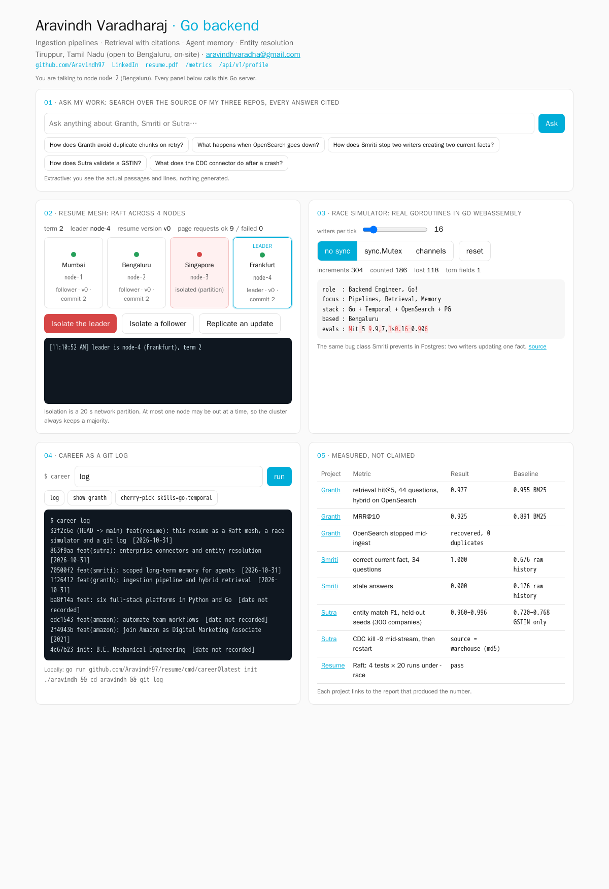

# resume

My resume, as a Go system you can poke at. One binary, standard library only, serves four panels:



1. **Ask my work.** Search over the source, READMEs and eval reports of [Granth](https://github.com/Aravindh97/granth), [Smriti](https://github.com/Aravindh97/smriti) and [Sutra](https://github.com/Aravindh97/sutra). It is extractive, with no LLM: every answer is the actual passage, with a link to the file and line range at the commit that was snapshotted.
2. **Resume mesh.** Four nodes replicate the resume with a Raft implementation written for this repo ([`internal/raft`](internal/raft/raft.go)). It covers leader election, log replication, commit by majority, and repair of a diverged log. You can **isolate the leader** and watch a new one get elected while the page keeps answering.
3. **Race simulator.** Real goroutines, compiled to WebAssembly, write to one shared resume record:
   - With **no sync**, writes tear ("Mit 5 9.9,7,1s0.l6-0.9" in the screenshot) and counter updates are lost.
   - With **sync.Mutex** or **channels** (a single owning goroutine), nothing is lost.
4. **Career as a git log.** `career log`, `career show granth` and `career cherry-pick skills=go,temporal`. `career init DIR` writes a **real git repository** with one commit per milestone.

A fifth panel shows each project's measured results next to its baseline, with a link to the report that produced every number.

## Try it

```bash
go run github.com/Aravindh97/resume/cmd/career@latest log
go run github.com/Aravindh97/resume/cmd/career@latest init ./aravindh && cd aravindh && git log --stat
```

```bash
git clone https://github.com/Aravindh97/resume && cd resume
make mesh            # 4 nodes: http://127.0.0.1:8081 .. 8084
make test
```

## How the mesh stays safe while strangers press "chaos"

- **Two listeners per node.**
  - The public one serves the page and `/api/v1/*`.
  - Raft RPCs, status and isolation live only on the private listener. It defaults to `127.0.0.1`, and on Fly.io it uses the private 6PN network. `TestPublicRoutes` checks that `/raft/*` returns 404 on the public side.
- **Chaos can't break the cluster.**
  - "Isolate" is a 20-second network partition. The node keeps its state, steps down if it was leader, and rejoins.
  - It's rate-limited cluster-wide, to one every 10 seconds.
  - It's refused while any node is already out, so 4 nodes always keep a majority of 3.
- **Bounded public input.**
  - The only write is "replicate an update", limited to one every 3 seconds. It only bumps the version.
  - Every client has a token-bucket rate limit (20 req/s, burst 40). The client IP comes from the socket or `Fly-Client-IP`, never from a spoofable `X-Forwarded-For`.
  - Request bodies are capped at 8 KB, with read, write and header timeouts.
- **Headers.** A strict Content-Security-Policy (no inline scripts; `wasm-unsafe-eval` is the one allowance, needed to run Go WebAssembly), plus `nosniff` and `frame-ancestors 'none'`.
- **No pprof on the public side.** `/metrics` exposes Prometheus counters only: goroutines, heap, GC, uptime, requests, rate-limited requests, and Raft term, leader and commit index.

**Verified locally**, with 4 nodes on loopback:
1. The leader node-1 was isolated.
2. node-2 won the term-2 election in under 2 s.
3. An update committed on the 3 remaining nodes.
4. A second chaos request was refused while node-1 was still out.
5. After the partition ended, node-1 rejoined as a follower and caught up to v2.

## Raft tests

[`internal/raft/raft_test.go`](internal/raft/raft_test.go) runs an in-memory network and covers:
- one leader per term, checked continuously for split brain
- replication to every node
- failover after the leader is isolated, with the old leader catching up
- no commit without a majority
- repair of a follower that missed entries

The suite passed 20 consecutive runs under `-race`.

Scope: state is in memory, membership is fixed, and there's no log compaction. That's enough for a resume, not for a database.

## Race simulator

[`internal/racesim`](internal/racesim/racesim.go) is compiled with `GOOS=js GOARCH=wasm`. Writers copy a value byte by byte and yield in between, the way a preempted thread would.
- The safe modes are tested under `-race`.
- The unsafe mode is a deliberate data race. `-race` would rightly reject it, so its test is built with `!race`, runs single-threaded like the browser, and passed 300 of 300 runs.

## Free hosting: GitHub Pages

The whole site also runs with no server. `make static` builds `dist/`. In that build, the Go WebAssembly module answers the same `/api/v1/*` routes inside the visitor's tab:
- search over the embedded repo snapshot
- the career CLI
- four real `internal/raft` nodes over an in-memory network ([`internal/browsermesh`](internal/browsermesh/mesh.go))

[`.github/workflows/pages.yml`](.github/workflows/pages.yml) builds and publishes it on every push to `main`. One-time setup: in the repo's **Settings → Pages**, set **Source** to **GitHub Actions**. The site is then at `https://aravindh97.github.io/resume/`.

The trade-off: on Pages the nodes share one tab, so the "network" is simulated. The multi-region version is the Fly.io deploy below, with the same Raft code over real HTTP.

## Deploy (Fly.io, paid)

```bash
fly auth login
PREFIX=aravindh-resume ./deploy/fly-deploy.sh   # 4 apps: bom, sin, fra, ams
```

Each app exposes only port 8080 through Fly's HTTPS proxy. Raft runs on `fly-local-6pn:9080`, using `<app>.internal` names on the organisation's private network. On Windows, run the script from Git Bash.

## Layout

```
cmd/site            one mesh node (public + private listeners)
cmd/career          the career CLI
cmd/racesim-wasm    browser entry point for the race simulator
internal/raft       Raft consensus
internal/racesim    shared-record race simulator
internal/career     milestones, log/show/cherry-pick, real git repo writer
internal/ask        BM25 over the snapshotted repos (scripts/snapshot-corpus.sh)
internal/site       HTTP server, templates, static assets
```
